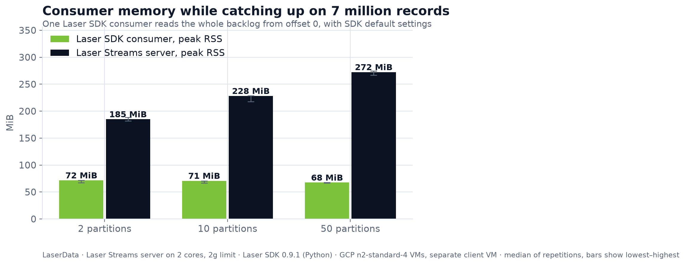
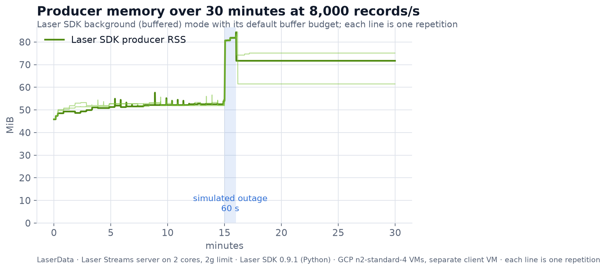
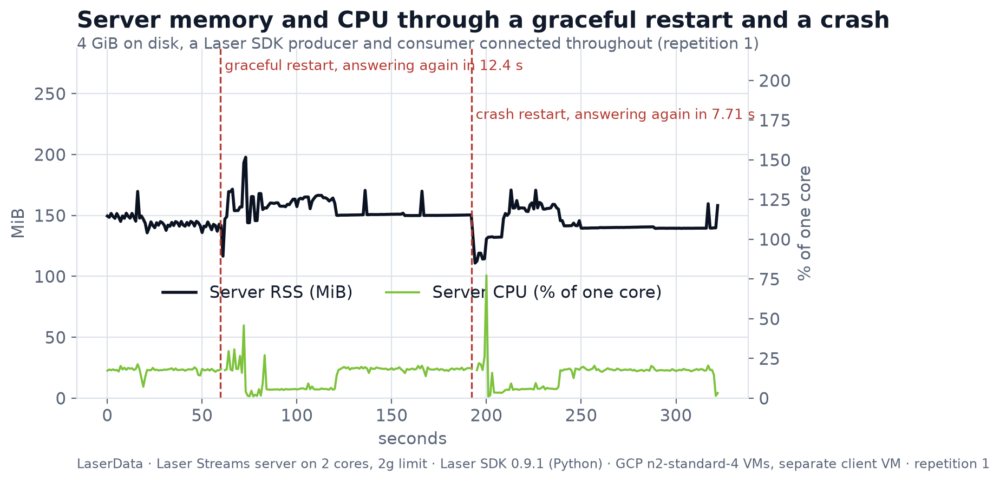

> **LaserData proof · Developer pain 03: Memory / CPU**  
> Blog: [Consumers that grow to 6 GB, producers that leak, brokers that spike on restart: we measured LaserData on all three](https://claude.ai/artifact/A674Dn6Tu3dXoLFVokeLwC#p.resource-blog) · Doc: [Size memory and CPU for LaserData](https://claude.ai/artifact/A674Dn6Tu3dXoLFVokeLwC#p.resource-doc) · Posts: [ready-to-publish drafts](https://claude.ai/artifact/A674Dn6Tu3dXoLFVokeLwC#p.posts~resource)  
> Where this code goes: the LaserData use-case repository, after LaserData engineering has reviewed it.  
> Status: measured self-hosted on Google Cloud VMs (3 repetitions). Results: [gcp-vm/results/sized-2g](gcp-vm/results/sized-2g/README.md). A LaserData Cloud (managed) run is next.

# LaserData footprint tests

Three tests that measure the memory and CPU of LaserData's server (Laser Streams) and of
Laser SDK clients in the situations engineers report most:

| Test | The problem it answers | What runs | Pass condition |
|---|---|---|---|
| `consumer_backlog.py` | A consumer that grows from 800 MB to 6 GB when partitions and lag go up | 7 million records (1 KiB) preloaded at 2, 10 and 50 partitions; one Laser SDK consumer reads them all from offset 0 | every record read once |
| `producer_pause.py` | A producer whose memory keeps climbing under sustained sends | Laser SDK producer, background mode, 8,000 records/s for 30 minutes; server frozen with `docker pause` for 60 s halfway; a consumer checks every record | no record missing unless the SDK reported it to the app |
| `restart.py` | A broker restart that spikes CPU and memory and stalls its neighbours | 4 GiB on disk; producer (5,000 records/s) and consumer connected; graceful restart, then `kill -9` and start | no confirmed record missing |

## Results at a glance (Google Cloud, median of 3)





## Where it runs

| Folder | Where | Client and server |
|---|---|---|
| [`gcp-vm/`](gcp-vm/README.md) | Self-hosted on Google Cloud VMs (`n2-standard-4`), one pair per test, all at once | Separate VMs in one zone, like an app and its streaming server |
| `run.sh` | Any Linux machine with Docker | Same machine, separate cores |

Both use the **sized-2g** server profile (`stack/sized-2g.yml`): Laser Stack's settings with the memory
pool at 512 MiB and the write-ahead log at its minimum (~128 MiB per partition), sized for the
2 GiB node, as the sizing guide recommends for small nodes. Laser Stack's shipped values are meant
for larger nodes.

## How it measures

- **Server:** Laser Streams and LaserData's managed backend, started with
  [Laser Stack](https://github.com/laserdata/laser-stack)'s own `scripts/up` at a pinned commit,
  with LaserData's shipped settings. `stack/limits.yml` is the only addition: it gives the server
  two dedicated cores and a 2 GiB memory limit, and puts the clients on the other cores.
- **Clients:** [Laser SDK](https://docs.laserdata.com/laser-sdk) for Python, SDK default settings.
  Record size (1 KiB) and batch size (100) are taken from LaserData's own benchmark suite.
- **Numbers:** `footprint/sampler.py` reads every process's resident memory and CPU from `/proc`
  and cgroup v2 once a second. The container total (which includes page cache) is recorded too.
- **Correctness:** every record carries a sequence number; missing or duplicate records are counted.

## Run it

**On Google Cloud, one command from your laptop:** `PROJECT=my-project gcp-vm/run-gcp.sh`
creates a server VM and a client VM per test, runs everything at once, brings the results back and
deletes the VMs. See [`gcp-vm/`](gcp-vm/README.md).

**On Linux with Docker:**

```bash
pip install -r requirements.txt
FOOTPRINT_SCALE=0.1 ./run.sh      # 8-minute trial
./run.sh                          # full run, about 1 hour
python footprint/summarize.py results   # if you put several runs in results/rep-*/
```

**Against your own LaserData deployment:** set `LASER_CONNECTION_STRING` and run the backlog test
directly, wrapping the consume step to get the client's peak memory. A Free Tier deployment is
capped at 200 KB/s, so use `FOOTPRINT_SCALE=0.01` there; full size needs a paid tier.

```bash
export LASER_CONNECTION_STRING='user:password@your-deployment:8090' FOOTPRINT_SCALE=0.01
python footprint/consumer_backlog.py preload --partitions 50
/usr/bin/time -v python footprint/consumer_backlog.py consume --partitions 50   # macOS: -l
```

**With a coding agent:** see `AGENTS.md`.

## Good to know

- LaserData's managed backend keeps its data only on disks with write barriers. Some CI runners and
  cloud images mount disks without them; `stack/data-disk.yml` shows how to give it a proper disk.
  Normal cloud persistent disks and local disks need nothing.
- The test consumer is one Python process handling one record at a time, so it reads roughly
  8,000–13,000 records/s. That is the test client's pace, so the results make no throughput claims.
- A long-running service should rebuild its consumer if the live stream ends after a long outage;
  it resumes from the group's stored offset. The tests do this and record how often it happened.

## Files

| File | Purpose |
|---|---|
| `run.sh` | Starts Laser Stack with the limits, runs the three tests, collects evidence |
| `stack/limits.yml` | Cores and memory limit for the server; the only change to Laser Stack |
| `stack/data-disk.yml` | CI only: data on a disk with write barriers |
| `footprint/sampler.py` | Per-second memory and CPU from the kernel |
| `footprint/consumer_backlog.py`, `producer_pause.py`, `restart.py` | The three tests |
| `footprint/summarize.py`, `charts.py` | Build `results/README.md`, `summary.json` and the charts |
| `gcp-vm/` | The Google Cloud setup: create VMs, run, collect, delete |

Built by the LaserData team.
