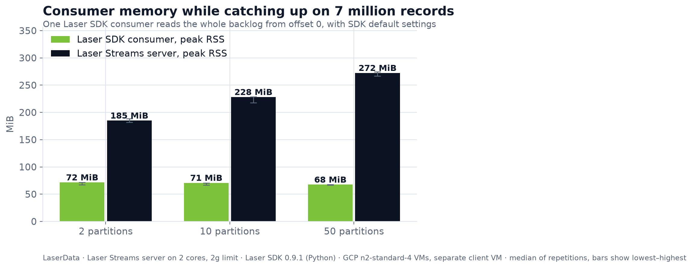
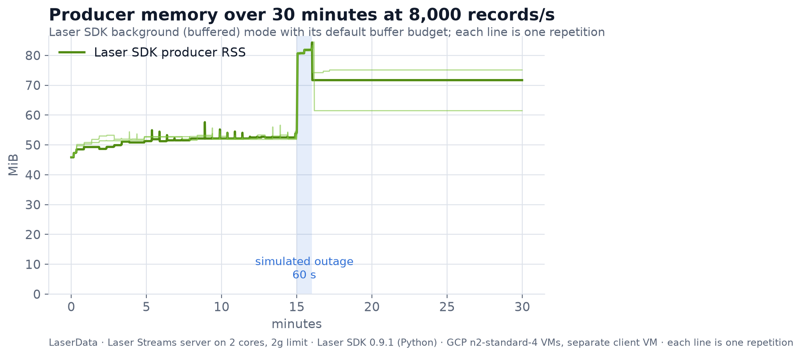
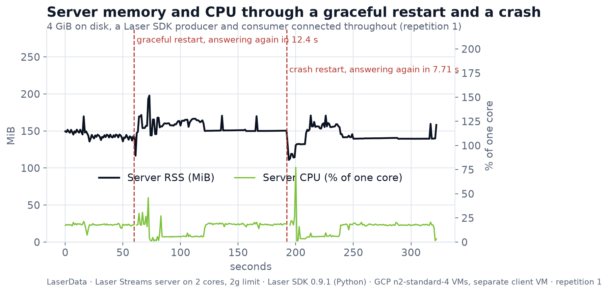

# Footprint results

Measured 2026-11-12 by [gcp-vm/run-gcp.sh](https://github.com/psinglap/laserdata-iggy-proof/tree/main/developer-pain/03-resource-footprint/gcp-vm), 3 repetitions, each on Google Cloud asia-south1-a: a server VM and a separate client VM per test, both n2-standard-4 with 4 dedicated vCPU; server data on a 100 GB SSD persistent disk (4 vCPU Intel(R) Xeon(R) CPU @ 2.80GHz, 15 GiB, kernel 7.0.0-1017-gcp).

Server: Laser Streams `server 0.10.1-ld` (`laserdatainc/iggy-server@sha256:348e27e6dca7a1a1b500e89d028dccc61ce7834ea9d76f4e621b3da6ed00a941`), from Laser Stack commit `46dd016`, LaserData's shipped settings, limited to 2g of memory and 2 dedicated cores. Clients: Laser SDK 0.9.1 for Python, SDK default settings, on separate cores.

Each cell is the median across repetitions, with the lowest and highest in brackets. Memory is resident memory (RSS) in MiB unless it says container, which also counts the page cache the kernel keeps for the server's files. CPU is percent of one core.

## Idle

| Server RSS | Server container | Server CPU | Managed backend RSS |
|---|---|---|---|
| 123 (120–130) | 102 (101–109) | 1.8% (1–3) | 53 (52–53) |

## 1. Consumer reading a 7 million record backlog

| Partitions | Consumer RSS peak | Consumer RSS median | Server RSS peak | Server container peak | Drain time (s) | Records/s | Missing |
|---|---|---|---|---|---|---|---|
| 2 | 72 (67–72) | 71 (66–71) | 185 (182–188) | 2,048 (2,048–2,048) | 897 (887–900) | 7,803 (7,782–7,889) | 0 |
| 10 | 71 (67–71) | 71 (67–71) | 228 (218–229) | 2,048 | 904 (888–967) | 7,739 (7,240–7,887) | 0 |
| 50 | 68 (67–68) | 64 (63–66) | 272 (266–274) | 2,048 (2,048–2,048) | 902 (865–927) | 7,761 (7,550–8,091) | 0 |

## 2. Producer for 30 minutes at 8,000 records/s, server paused for 60 s halfway

| Producer RSS before | Peak while paused | Peak after resume | Last 2 minutes | Growth before pause (MiB/h) | Growth after (MiB/h) | Reported to app as failed | Missing | Missing and not reported |
|---|---|---|---|---|---|---|---|---|
| 52 (52–52) | 83 (82–83) | 84 (83–85) | 72 (62–75) | 3.5 (2–15) | 0 | 1,100 | 0 (0–1,000) | 0 |

## 3. Server restart with 4 GiB on disk, producer and consumer connected

Steady before restart: server RSS 144 (141–146), CPU 19% (18–25).

| Restart | Server answers (s) | Producer writes again (s) | Consumer reads again (s) | Server RSS peak, first 60 s | Container peak | CPU peak |
|---|---|---|---|---|---|---|
| graceful | 12 (12–13) | 20 (14–22) | 20 (18–22) | 238 (198–259) | 2,048 (2,048–2,048) | 46% (36–64) |
| crash | 8 (8–8) | 10 (10–14) | 15 (11–17) | 169 (157–171) | 1,880 (1,869–2,048) | 77% (75–115) |

Confirmed records missing after both restarts: 0.

## Charts

Raw evidence for every repetition is in `rep-*/`: `samples.csv` (one row per second per process), `events.jsonl`, one JSON per test and `env.json`. SVG versions of the charts are in `charts/`.
