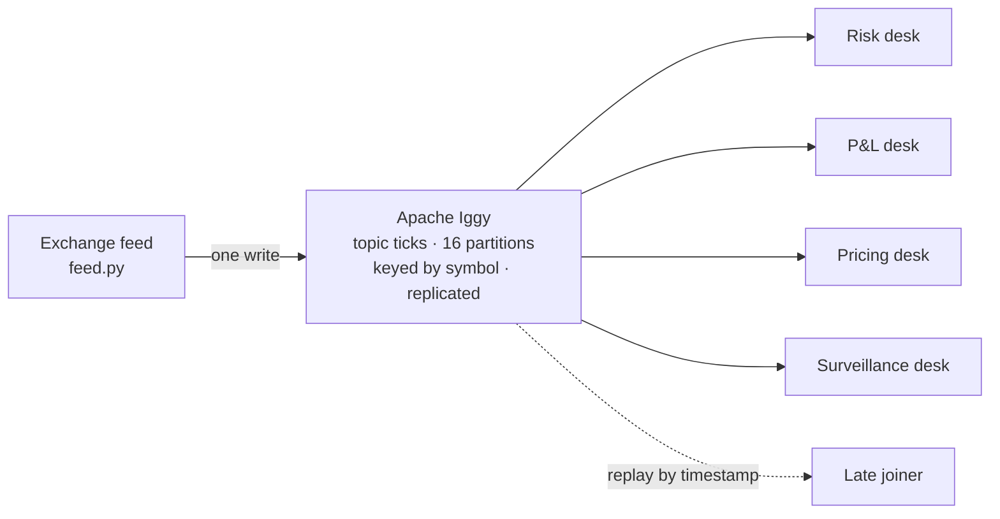

# Getting every stock price update to every trading system in under 5 ms with LaserData

Trading firms, brokers and exchanges send each price update from an exchange feed to many internal
systems at once. This repo builds that layer with LaserData on Apache Iggy, the open-source streaming engine LaserData builds. It shows why the slowest updates decide
whether it works, and lets you test it on your own machines.

**In short**
- **The job:** every tick to every internal reader (risk, P&L, pricing, surveillance), in order per symbol, inside a 5 ms end-to-end p99 at the opening bell.
- **Why Iggy:** Rust, thread-per-core, no garbage collector; consumer groups read one copy of the data; replay by timestamp; replicated writes since 0.9.
- **What you get:** a five-minute demo, three market-open tests with pass lines, and a benchmark against latency-tuned Kafka anyone can rerun.

> Status: draft. The code targets the `apache-iggy` 0.9.0 Python SDK and the `apache/iggy:0.9.0`
> image. Benchmark runs are pending; no results are published yet.

## The problem: every trading system needs every tick at the opening bell

At 9:30 in New York the opening bell rings, and order books that were quiet a minute ago start changing
thousands of times a second. Every tick has more than one reader: risk recomputes exposure, P&L
marks positions, pricing quotes clients, surveillance looks for spoofing. Each needs every tick, in
order for its symbol, as soon as possible. If one desk sees a tick 40 ms late, it acts on a price
that no longer exists. Nobody notices the average. Everyone notices the late ticks in the busiest
second of the day.



The job has four requirements, and every design choice below traces back to one of them:

| Requirement | What it means |
|---|---|
| Order per symbol | Never tick 48,212 before 48,211 for the same stock. |
| Every desk gets every tick | No sampling. Adding a desk must not slow the others. |
| Fast at the slowest tick | The promise is p99 and p99.9 at the busiest second. |
| Recovery without gaps | A desk that restarts or joins late catches up and proves it missed nothing. |

## The latency budget for market data is 5 ms, end to end

A tier-1 bank's published target for critical trading pipelines is **under 5 ms p99, end to end, at
1.6M messages a second, with `acks=all`** ([Confluent](https://confluent.io/blog/tier-1-bank-ultra-low-latency-trading-design/)).
The feed handler, network, broker and desk all share that budget.

| Broker hop, published p99 | Setup | Source |
|---|---|---|
| Apache Kafka: 5 ms | 3 brokers, 200 MB/s, 2020 | [Confluent](https://www.confluent.io/blog/kafka-fastest-messaging-system/) |
| Apache Iggy: 2.94 ms | 0.9.0 dev snapshot, 3 nodes, persisted, 20 producers, "not final" | [Iggy 0.9.0](https://iggy.apache.org/blogs/2026/09/21/release-0.9.0) |

Different setups, different years, both vendor-run. Neither answers the question for your feed,
which is why this repo includes a benchmark anyone can rerun.

## Why the slowest price updates, not the average, decide success

At 1.6M ticks a second, "p99 under 5 ms" still allows **16,000 ticks every second** to be late.
p99.9 is 1,600 a second. That is why every desk here prints p99 and p99.9 once a second.

In a JVM broker, long tails usually come from garbage-collection pauses (every partition waits at
once), shared request pools (one slow write delays unrelated partitions) and bursty page-cache
flushes. Iggy is written in Rust, so there is no GC, and it runs thread-per-core on `io_uring`:
each core owns its partitions and does its own I/O, so requests are never handed between threads.
That removes classes of stalls. It does not make disks or networks faster.

## The design: distributing prices with LaserData

- **Partition by symbol, for order.** The producer keys each tick by its symbol's bucket, so a symbol always lands on one partition.
- **A sequence number in every tick, to prove it.** Each desk skips `seq <= last` (a re-read after restart) and counts `seq > last + 1` as a gap. Zero gaps is a pass condition.
- **One consumer group per desk, so fan-out costs nothing extra.** The log is written once; each desk keeps its own offsets.
- **Replay by timestamp, for recovery.** A late desk starts at "five minutes ago", catches up, then goes live.
- **Replicated writes.** Durability is not traded for latency, on either side of the benchmark.

## Build the fan-out: a feed, four desks and a late joiner

Needs Docker and Python 3.10+.

```bash
docker compose up -d                 # Apache Iggy 0.9.0 on :8090
pip install -r requirements.txt      # apache-iggy 0.9.0
python feed.py --rate 20000 &        # 500 symbols, 128-byte ticks
python desk.py --name risk &
python desk.py --name pnl
```

The producer ([`feed.py`](feed.py)):

```python
producer = await client.producer("market", "ticks",
    topic_partitions_count=16, topic_durability=Durability.REPLICATED)
await producer.send_with_partitioning(ticks, Partitioning.messages_key(bucket))
```

A desk ([`desk.py`](desk.py)) is a consumer group that measures send-to-receive time and checks sequences:

```python
desk = await client.consumer_group("risk", "market", "ticks",
    polling_strategy=PollingStrategy.Next(),
    auto_commit=AutoCommit.Interval(timedelta(seconds=1)))
```

The late joiner ([`late_joiner.py`](late_joiner.py)) is the same consumer with
`PollingStrategy.Timestamp(five_minutes_ago_us)`.

Each desk prints a line every second:

```
[risk]  20,000/s  p50 …µs  p99 …µs  p99.9 …µs  max …µs  gaps 0  PASS (<5,000µs)
```

**Plug in your own feed** by replacing the generator loop in `feed.py`. Keep two rules: key by
symbol, and send a per-symbol sequence number. Python tops out around 50K ticks/s, so the demo
shows behaviour; peak numbers come from the Rust benchmark.

## Test it under market-open conditions

| Test | Run | Pass |
|---|---|---|
| Market-open burst | `python feed.py --rate 20000 --burst 10 --burst-at 30 --burst-for 60` | Every desk's p99 stays under 5 ms through the 10× spike; gaps stay 0. |
| Kill a desk | Ctrl-C the risk desk, wait 30 s, `python desk.py --name risk` | Resumes from its committed offset with no gaps; up to one second is redelivered and skipped by sequence. |
| Join late | `python late_joiner.py --since 300` | Catches up on all 500 symbols with 0 gaps, then goes live. |

## Benchmark it against latency-tuned Kafka

The question: can a replicated Iggy cluster deliver every tick to every desk within 5 ms p99 at
1.6M ticks/s, and can Kafka, tuned for latency, do the same on the same machines? The full plan,
with the reason for every parameter, is in [`bench/PLAN.md`](bench/PLAN.md). In short: 128-byte
ticks, 16 partitions, 4 consumer groups, replicated on both sides (Kafka `acks=all`, RF 3), Kafka on
`linger.ms=0`, rate steps to 1.6M/s, a 10× burst, 30 minutes per step plus a 24-hour soak, three
runs per step, a persisted run (fsync before ack) at 1M/s, a leader kill at minute 15, and every config and raw output committed. If Kafka wins a step, that row is published.

```bash
bench/run-iggy.sh                                   # iggy-bench, all rate steps
# Kafka: OpenMessaging Benchmark with bench/kafka/*.yaml
python bench/compare.py results.csv                 # p99 vs rate, 5 ms line drawn
```

**Pass line:** p99 under 5 ms end to end at 1.6M ticks/s, replicated, with zero gaps at every desk.

## Running it in production

| Area | Apache Iggy 0.9 today |
|---|---|
| Replication | Viewstamped Replication; 3 nodes tolerate 1 failure, 5 tolerate 2; SDKs follow the leader and fail over |
| Durability | Per topic: `replicated` acks once a quorum holds the write (like `acks=all`); `persisted` also waits for stable storage |
| Retention | Message expiry or size cap per topic; keep a trading day for replay; S3 archiving for longer |
| Security | TLS on every transport; users, permissions, access tokens; optional AES-256-GCM payload encryption |
| Observability | Prometheus metrics; the desks add per-second p99 and gap counts |
| Clients | Rust, Go, Java, C#, Python, Node.js |

**LaserData Cloud** runs the same engine managed on AWS or GCP, or in your own account (BYOC), on three
dedicated nodes with local NVMe, adding a console, CLI, RBAC, audit logs, metrics, snapshots and upgrades.

## Frequently Asked Questions

**Is `replicated` the same as Kafka's `acks=all`?** Close: both ack once a majority holds the write and
neither fsyncs per message by default. The benchmark also runs `persisted` against Kafka flushing every message.

**What happens when a node dies?** A new leader is elected for the affected partitions and SDKs redirect.
Desks resume from committed offsets; sequence numbers show anything skipped. The benchmark kills a leader mid-run.

**Doesn't polling add latency?** Up to the poll interval. Desks poll every 100 µs; the benchmark reports
client CPU alongside latency. Deferred polling is on the Iggy roadmap.

**How is end-to-end measured across machines?** Each tick carries its send time. Producers and consumers
share the load-generator host in the benchmark; across hosts, use PTP or chrony.

**Can I keep my Kafka producers?** Not directly yet: the Kafka gateway does not accept produce/fetch in 0.9.
To shadow an existing feed, run [`kafka_bridge.py`](kafka_bridge.py), which copies a Kafka tick topic into Iggy keyed by symbol.

**Exactly-once?** No, at-least-once. Desks skip ticks they have seen by sequence number; Iggy can also
deduplicate on the server by message ID.

**Is 0.9 mature enough?** Clustering shipped in September 2026 and 0.9 changed the wire and disk formats.
Start with a shadow run beside your existing feed and decide on your own market opens.

## Where it does not fit

The matching engine stays in memory (Aeron, Chronicle). Pipelines built on Kafka Connect or
transactions should wait for Iggy's Kafka-compatible gateway. Iggy belongs in the tier behind the
engine: fan-out, risk and replay.

## Files

| File | What it does |
|---|---|
| `feed.py` | Synthetic feed: N symbols, steady rate, 10× burst, per-symbol sequence numbers |
| `desk.py` | One desk = one consumer group; prints p50/p99/p99.9/max and gaps every second |
| `late_joiner.py` | Replays the last N seconds by timestamp, checks every sequence, reports catch-up speed |
| `common.py` | 48-byte tick format and the rolling latency window |
| `kafka_bridge.py` | Copies an existing Kafka tick topic into Iggy for a shadow run |
| `bench/` | Benchmark plan, iggy-bench script, OpenMessaging Benchmark configs for Kafka, chart script |
